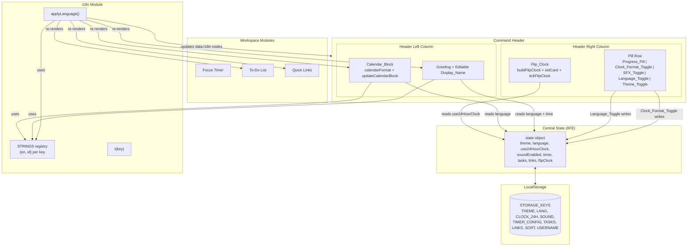

# Design Document

## Introduction

This document describes the technical design for the To-Do List Life Dashboard feature iteration. The dashboard is a single-page web application built with HTML, CSS, and Vanilla JavaScript (no frameworks, no build step, no backend), persisting all data in browser LocalStorage.

This iteration introduces three changes on top of the existing dashboard:
1. A long-format **Calendar_Block** (top-left) that localizes between English and Indonesian.
2. A live animated **Flip_Clock** (top-right) that replaces the old text-based hero clock.
3. An **EN/ID Language_Toggle** that localizes all UI text between English and Indonesian.

All existing features (dark/light theme, SFX, focus timer, to-do list, quick links, editable name, confetti/spotlight effects, LocalStorage persistence) are preserved and integrated with the new localization system.

The design respects the hard technical constraint (Requirement 16): exactly one CSS file in `css/` and one JS file in `js/`, no frameworks, no build step. New logic is added as numbered modules inside the existing single-file IIFE in `js/app.js`.

## Overview

The dashboard follows a unidirectional data-flow architecture centered on a single mutable `state` object inside one IIFE. User interactions mutate `state`, which is then persisted to LocalStorage and re-rendered to the DOM. This iteration adds three cooperating modules to that existing flow:

- **i18n module** — a `STRINGS` registry plus `t(key)` and `applyLanguage()` that re-render every localized DOM element when the language changes.
- **Flip_Clock module** — builds six split-flap digit cards and animates them on a 250ms tick, driven by the same `state.use24HourClock` flag the existing clock-format toggle already manages.
- **Calendar_Block module** — a pure date formatter (`calendarFormat`) plus a DOM updater that localizes the rendered date string.

The header is restructured so the calendar block and greeting occupy the left column, while the flip clock and the header pill row occupy the right column. The pill row gains a new Language_Toggle between the SFX and Theme toggles.

### Scope

In scope:
- Header HTML restructure (calendar block left, flip clock right).
- Flip clock CSS and JS (adapted from the `FipClock-v2.2.html` reference, scaled to fit the header, themed via existing CSS variables).
- Calendar block formatter and renderer (EN via `Intl.DateTimeFormat`, ID via manual name arrays).
- i18n system: `STRINGS` object, `t()`, `applyLanguage()`, language toggle button, pre-paint language application.
- State additions (`state.language`, `state.flipClock`, `STORAGE_KEYS.LANG`).
- Five correctness properties for property-based testing.

Out of scope (preserved unchanged unless integration is required):
- Focus timer, to-do list, quick links CRUD logic, theme/SFX/audio synthesis, confetti/spotlight effects. These are reused as-is; only their render functions are wired to re-run on language change.

## Architecture

### High-Level Component Architecture



### Data Flow

The application uses a single-direction data flow. Every interaction follows the same lifecycle:

```
User action / interval tick
  → Event handler (or tick function)
    → Mutate state object
      → saveToStorage() for persisted slices
      → Re-render affected DOM (renderTasks / renderQuickLinks / updateCalendarBlock / tickFlipClock / applyLanguage)
```

Two interval-driven loops exist:
1. **1-second loop** (existing) — drives greeting time-of-day updates and calendar date rollover. Refactored to call `updateCalendarBlock()` and `updateGreeting()` instead of the old monolithic `updateClockAndGreeting()`.
2. **250ms loop** (new) — drives the flip clock digit animation via `tickFlipClock()`.

The flip clock uses a faster interval (250ms vs the text clock's 1000ms) so each per-second digit flip animation has time to complete before the next tick re-checks, matching the reference implementation.

### Module Organization (app.js IIFE)

The existing IIFE is organized into numbered sections. The new modules are inserted as new numbered sections, keeping the single-file constraint:

| Section | Existing / New | Responsibility |
|---------|---------------|----------------|
| 1. Storage Keys & Defaults | Modified | Add `STORAGE_KEYS.LANG`, add `DEFAULT_NAME_FALLBACK` |
| 2. Application State | Modified | Add `state.language`, `state.flipClock` |
| 3. Local Storage Helpers | Modified | Hydrate `state.language` |
| 4. Web Audio | Unchanged | SFX synthesis |
| 5. DOM References | Modified | Cache new flip clock + calendar + language toggle refs |
| 6. Theme & Header Controls | Modified | Refactor greeting into `updateGreeting()`; add `updateCalendarBlock()` |
| 7. Focus Timer | Unchanged | Timer logic |
| 8. To-Do List | Modified | Render functions call `t()` for localized strings |
| 9. Quick Links | Modified | Render functions call `t()` for localized strings |
| 10. Visual Effects | Unchanged | Spotlight + confetti |
| 11. Event Listeners | Modified | Add language toggle handler; clock-format handler also triggers `tickFlipClock()` |
| **12. i18n Module** | **New** | `STRINGS`, `t()`, `applyLanguage()` |
| **13. Flip Clock Module** | **New** | `buildFlipClock()`, `setCard()`, `tickFlipClock()` |
| 14. Event Bindings | Renumbered | |
| 15. Initialization | Modified | Build flip clock, apply language, start intervals |

## Components and Interfaces

### Calendar_Block

Renders the current date in long format, localized. Replaces the old small `date-badge` span.

**Interface (internal functions):**

```javascript
// Pure: returns a localized long-format date string. No DOM access.
// EN: "Friday, November 6, 2026"
// ID: "Jumat, 6 November 2026"
function calendarFormat(date, lang) → string

// Side-effectful: reads state.language, writes to dom.calendarDate.
function updateCalendarBlock() → void
```

**EN implementation** uses the browser's `Intl.DateTimeFormat`:
```javascript
new Intl.DateTimeFormat('en-US', {
  weekday: 'long', year: 'numeric', month: 'long', day: 'numeric'
}).format(date)
// → "Friday, November 6, 2026"
```

**ID implementation** uses manual name arrays because Indonesian locale formatting varies across browsers and engines. Two constant arrays drive it:
```javascript
const ID_WEEKDAYS = ['Minggu','Senin','Selasa','Rabu','Kamis','Jumat','Sabtu'];
const ID_MONTHS = ['Januari','Februari','Maret','April','Mei','Juni',
                   'Juli','Agustus','September','Oktober','November','Desember'];
// Template: `${weekday}, ${day} ${month} ${year}`
// → "Jumat, 6 November 2026"
```

**Design decision — manual ID arrays over `Intl` for Indonesian:** `Intl.DateTimeFormat('id-ID', ...)` output is not guaranteed consistent across Chrome, Firefox, Edge, and Safari (different ICU versions, casing differences, trailing commas). Hardcoding the 7 weekday and 12 month names is a small, stable lookup table that guarantees the exact format specified in Requirement 1.3. English uses `Intl` because the `en-US` locale is universally stable across all target browsers.

**Update trigger:** The existing 1-second interval calls `updateCalendarBlock()`. It only writes to the DOM when the formatted string changes (diff check on `lastDateString`), so it is cheap to run every second and reliably catches the midnight rollover (Requirement 1.4).

### Flip_Clock

An animated split-flap card clock rendering HH:MM:SS, adapted from `FipClock-v2.2.html`, scaled to fit the header, themed via existing CSS variables.

**Interface (internal functions):**

```javascript
// Side-effectful (DOM construction): creates 6 digit cards + separators + AM/PM label
// inside the flip clock container. Stores card refs in state.flipClock.cards.
function buildFlipClock() → void

// Side-effectful: animates a single card to display a new single-character digit.
// First render sets the value with no animation. Subsequent changes trigger the flip.
function setCard(card, value) → void

// Side-effectful: reads state.use24HourClock + state.language(ignored for digits),
// computes the 6-digit string from new Date(), calls setCard for each changed digit.
function tickFlipClock() → void
```

**DOM structure per card** (identical to reference, themed via CSS variables):
```html
<div class="flip-card" data-v="">
  <div class="flip-half flip-top"><span></span></div>
  <div class="flip-half flip-bottom"><span></span></div>
  <div class="flip-flap flip-flap-top"><span></span></div>
  <div class="flip-flap flip-flap-bottom"><span></span></div>
</div>
```

Six cards are arranged as three groups (HH, MM, SS) separated by two separator columns, each containing two blinking dots. An AM/PM label follows the seconds group, visible only in 12-hour mode.

**Animation mechanics** (from reference):
- `setCard` compares the new value to `card.dataset.v`. If unchanged, it returns early (no animation).
- On first render (`dataset.v === ""`), it sets the digit text on both static halves with no animation.
- On a real change, it sets the falling flap (old value) and arriving flap (new value), updates the static top to the new value, then applies the `.flipping` class (forcing a reflow first so the animation restarts). After 620ms it updates the static bottom and removes the `.flipping` class.
- CSS keyframes: `flipTop` (0.3s ease-in, rotates the top flap down from 0deg to -90deg) and `flipBottom` (0.3s ease-out with 0.3s delay, rotates the bottom flap from 90deg to 0deg).

**12h/24h integration:** `tickFlipClock()` reads `state.use24HourClock`. In 12-hour mode it computes `h = hours % 12 || 12` and shows the AM/PM label (`h >= 12 ? 'PM' : 'AM'`). In 24-hour mode it hides the AM/PM label and uses `hours` directly. The existing clock-format toggle handler (`dom.clockFormatBtn`) flips `state.use24HourClock`, persists it, and now also calls `tickFlipClock()` immediately so the flip clock refreshes without waiting for the next 250ms tick.

**Theming:** The reference hardcodes dark colors. The integrated version replaces all hardcoded colors with existing CSS custom properties so the flip clock adapts to the light/dark theme:

| Reference value | Integrated value |
|-----------------|-------------------|
| card background `#1b1b1f` | `var(--bg-elevated)` |
| top half `#222227` | `var(--bg-elevated)` |
| bottom half `#1a1a1e` | `var(--bg-card)` |
| digit color `#f2f2f2` | `var(--text-primary)` |
| separator `#ff9f1c` | `var(--accent-primary)` |
| seam `#0c0c0e` | `var(--bg-canvas)` |
| card shadow | `var(--shadow-card)` |

**Sizing:** Cards are scaled down from the reference (120×180px) to fit the header. Using CSS custom properties scoped to the flip clock container:
```css
.flip-clock { --flip-w: 42px; --flip-h: 64px; --flip-digit: 56px; }
```
All internal dimensions reference these variables, so responsive scaling (Requirement 14) is a single-variable change. The mobile breakpoint reduces these further.

### i18n Module

A string registry plus a translation function and a DOM re-renderer.

**Interface:**

```javascript
// Registry: every key maps to { en: string, id: string }
const STRINGS = { key: { en: '...', id: '...' }, ... };

// Pure: returns the string for key in state.language, with optional {placeholder} interpolation.
function t(key, params?) → string

// Side-effectful: re-renders every [data-i18n] element, updates placeholders,
// select options, calendar, greeting, and re-renders tasks + links.
function applyLanguage() → void
```

**`t(key, params)` interpolation:** Strings containing `{name}` tokens are interpolated from a `params` object, e.g. `t('progress.tasks', { done: 3, total: 5 })` → `"3/5 Tasks Done"`. This keeps the render functions clean.

**`applyLanguage()` responsibilities:**
1. Set `document.documentElement.lang` to `'en'` or `'id'` (accessibility, Requirement 5).
2. Iterate every element with a `data-i18n` attribute and set its `textContent` to `t(attrValue)`.
3. Iterate every element with a `data-i18n-placeholder` and set its `placeholder` attribute.
4. Update the `<option>` text inside the sort `<select>` (options carry `data-i18n`).
5. Update the language toggle button label to show the active language code.
6. Call `updateGreeting()` (re-localizes greeting prefix by time of day).
7. Call `updateCalendarBlock()` (re-localizes the date).
8. Call `renderTasks()` (re-localizes empty states, button titles, counter text).
9. Call `renderQuickLinks()` (re-localizes empty state, restore button).

**`data-i18n` attribute convention:** Static text elements in `index.html` carry `data-i18n="key"`. At language change, `applyLanguage()` resolves the key and writes `textContent`. Dynamic strings (task counter, progress pill, duplicate warning) are set imperatively by their render functions calling `t()` directly, since their values depend on runtime state.

**Pre-paint application (Requirement 5.7):** A small inline `<script>` block in `<head>`, alongside the existing theme-flash prevention, reads `life_dashboard_lang` from LocalStorage and sets `document.documentElement.lang` and a `data-lang` attribute before first paint. The full `applyLanguage()` runs after DOM ready in `init()`. This prevents a language flash on reload.

### Language_Toggle

A header pill button placed between the SFX_Toggle and Theme_Toggle.

**Behavior:**
- Clicking toggles `state.language` between `'en'` and `'id'`.
- Persists via `saveToStorage(STORAGE_KEYS.LANG, state.language)`.
- Calls `applyLanguage()` to re-render all localized UI.
- Displays the active language code (`"EN"` or `"ID"`) as its label, updated by `applyLanguage()`.

### Integration with Existing Modules

| Existing module | Integration point | Change |
|-----------------|-------------------|--------|
| Clock format toggle | `dom.clockFormatBtn` click handler | After toggling `state.use24HourClock`, also call `tickFlipClock()` for immediate refresh |
| Theme | `applyTheme()` | No change; flip clock + calendar auto-adapt via CSS variables |
| SFX toggle | `updateSoundToggleUI()` | Label text via `t('sfx.on')` / `t('sfx.muted')` |
| Theme toggle label | `applyTheme()` | Label text via `t('theme.dark')` / `t('theme.light')` |
| Greeting | New `updateGreeting()` extracted from old `updateClockAndGreeting()` | Uses `t('greeting.morning')` etc. based on time + language |
| To-Do render | `renderTasks()` | Empty-state titles/descriptions, counter pill, clear-done button title, duplicate warning all via `t()` |
| Quick Links render | `renderQuickLinks()` / `addQuickLink()` | Empty state, restore button, error messages via `t()` |
| Name editing | `commitUserName()` | Fallback name via `t('name.default')`; saved badge via `t('name.saved')` |
| Keyboard shortcuts | `bindEvents()` | Unchanged; the `/`, `Alt+T`, `Alt+S` shortcuts work regardless of language |
| Init | `init()` | Build flip clock, apply language, start flip clock 250ms interval, call `updateCalendarBlock()` + `updateGreeting()` |

## STRINGS i18n Object — Key Catalog

The `STRINGS` object keys required to cover all localized UI text (Requirement 5.3):

| Key | EN | ID |
|-----|----|----|
| `card.focusTimer` | Focus Timer | Timer Fokus |
| `card.tasks` | Today's Tasks | Tugas Hari Ini |
| `card.links` | Quick Links | Tautan Cepat |
| `greeting.morning` | Good morning, | Selamat pagi, |
| `greeting.afternoon` | Good afternoon, | Selamat siang, |
| `greeting.evening` | Good evening, | Selamat sore, |
| `greeting.night` | Good night, | Selamat malam, |
| `name.default` | Friend | Teman |
| `name.saved` | Saved | Tersimpan |
| `btn.addTask` | Add Task | Tambah Tugas |
| `btn.addLink` | Add Link | Tambah Tautan |
| `btn.saveLink` | Save Link | Simpan Tautan |
| `btn.cancel` | Cancel | Batal |
| `btn.clearDone` | Clear Done | Hapus Selesai |
| `btn.start` | Start | Mulai |
| `btn.pause` | Pause | Jeda |
| `btn.resume` | Resume | Lanut |
| `btn.reset` | Reset | Atur Ulang |
| `timer.ready` | Ready | Siap |
| `timer.focusing` | Focusing... | Fokus... |
| `timer.paused` | Paused | Jeda |
| `timer.complete` | Session Complete! | Sesi Selesai! |
| `timer.minLabel` | Min: | Men: |
| `timer.target` | {m}m target • {n} sessions done | {m}m target • {n} sesi selesai |
| `timer.sessionSingular` | 1 session done | 1 sesi selesai |
| `filter.all` | All | Semua |
| `filter.active` | Active | Aktif |
| `filter.completed` | Completed | Selesai |
| `sort.label` | Sort by: | Urutkan: |
| `sort.incomplete` | Incomplete First | Belum Selesai |
| `sort.newest` | Newest First | Terbaru |
| `sort.oldest` | Oldest First | Terlama |
| `sort.alpha` | Alphabetical (A–Z) | Abjad (A–Z) |
| `task.placeholder` | Add a new task for today... | Tambahkan tugas baru untuk hari ini... |
| `progress.tasks` | {done}/{total} Tasks Done | {done}/{total} Tugas Selesai |
| `counter.done` | {done} of {total} done | {done} dari {total} selesai |
| `dup.warning` | Duplicate prevented: "{text}" is already in your list. | Duplikat dicegah: "{text}" sudah ada di daftar Anda. |
| `empty.allTitle` | Your task list is clear | Daftar tugas Anda kosong |
| `empty.allDesc` | Add a task above to structure your day with intention. | Tambahkan tugas di atas untuk menyusun hari Anda. |
| `empty.activeTitle` | All tasks completed! | Semua tugas selesai! |
| `empty.activeDesc` | Every single item on your list is checked off. Great work today. | Semua item di daftar Anda sudah dicentang. Kerja bagus hari ini. |
| `empty.completedTitle` | No completed tasks yet | Belum ada tugas selesai |
| `empty.completedDesc` | Check off a task as you make progress through your day. | Centang tugas saat Anda membuat kemajuan sepanjang hari. |
| `links.empty` | No quick links saved yet. | Belum ada tautan cepat tersimpan. |
| `links.restore` | Restore Starter Links | Pulihkan Tautan Awal |
| `link.titlePlaceholder` | Title (e.g., Figma) | Judul (mis., Figma) |
| `link.urlPlaceholder` | URL (e.g., figma.com) | URL (mis., figma.com) |
| `link.errorTitle` | Please enter a short title. | Silakan masukkan judul singkat. |
| `link.errorUrl` | Please enter a valid website URL. | Silakan masukkan URL yang valid. |
| `link.errorDup` | This website is already in your Quick Links. | Situs ini sudah ada di Tautan Cepat Anda. |
| `sfx.on` | SFX On | SFX Aktif |
| `sfx.muted` | Muted | Bisu |
| `theme.dark` | Dark | Gelap |
| `theme.light` | Light | Terang |
| `footer.text` | All data is stored locally in your browser via Local Storage. Double-click any task to edit inline. | Semua data disimpan secara lokal di browser Anda melalui Local Storage. Klik dua kali tugas untuk mengedit. |
| `footer.newTask` | New Task | Tugas Baru |
| `footer.timer` | Start/Pause Timer | Mulai/Jeda Timer |
| `footer.theme` | Toggle Theme | Ganti Tema |

Note: "12H" / "24H" on the clock format toggle are kept language-neutral (technical labels), as are the AM/PM labels. The language toggle button shows `"EN"` or `"ID"` representing the currently active language, not a translated word.

## Data Models

### Application State Object

The central `state` object (existing fields shown unmodified, new fields marked):

```javascript
const state = {
  theme: 'light' | 'dark',             // existing
  username: 'Alex',                     // existing
  use24HourClock: false,               // existing
  soundEnabled: true,                  // existing
  language: 'en' | 'id',               // NEW — current UI language
  timer: {                            // existing, unchanged
    durationMinutes: 25,
    remainingSeconds: 1500,
    isRunning: false,
    intervalId: null,
    sessionsCompleted: 0
  },
  tasks: [],                           // existing, Task[]
  taskFilter: 'all' | 'active' | 'completed',   // existing
  taskSort: 'incomplete' | 'newest' | 'oldest' | 'alpha',  // existing
  editingTaskId: null,                 // existing
  links: [],                           // existing, Link[]
  flipClock: {                         // NEW — flip clock DOM refs
    cards: [],                         //   array of 6 card HTMLElements
    lastDigits: '',                    //   last rendered 6-char digit string
    ampmEl: null                        //   AM/PM label element ref
  }
};
```

### Entity Models

**Task** (unchanged):
```typescript
interface Task {
  id: string;          // 'task-' + timestamp + random suffix
  text: string;        // whitespace-normalized
  completed: boolean;
  createdAt: number;   // Date.now() timestamp
}
```

**Link** (unchanged):
```typescript
interface Link {
  id: string;          // 'link-' + timestamp
  title: string;
  url: string;         // normalized, always has https:// prefix
}
```

### LocalStorage Schema

| Key (`STORAGE_KEYS.*`) | Storage key string | Format | Default | Status |
|---|---|---|---|---|
| `THEME` | `life_dashboard_theme` | raw string `'light'\|'dark'` | OS preference | existing |
| `USERNAME` | `life_dashboard_username` | raw string | `'Alex'` | existing |
| `CLOCK_24H` | `life_dashboard_clock_24h` | JSON boolean | `false` (12h) | existing |
| `SOUND` | `life_dashboard_sound` | JSON boolean | `true` | existing |
| **`LANG`** | **`life_dashboard_lang`** | **raw string `'en'\|'id'`** | **`'en'`** | **NEW** |
| `TIMER_CONFIG` | `life_dashboard_timer_config` | JSON `{durationMinutes, sessionsCompleted}` | `{25, 0}` | existing |
| `TASKS` | `life_dashboard_tasks` | JSON `Task[]` | `DEFAULT_TASKS` | existing |
| `LINKS` | `life_dashboard_links` | JSON `Link[]` | `DEFAULT_LINKS` | existing |
| `SORT` | `life_dashboard_sort` | raw string | `'incomplete'` | existing |

**Design decision — `LANG` stored as a raw string (not JSON):** Language codes are simple strings (`'en'`/`'id'`), matching the pattern already used for `THEME` and `SORT` (raw strings), keeping hydration trivial: `localStorage.getItem` returns the string directly or `null`. This avoids the JSON parse overhead and aligns with the existing raw-string convention for preference flags.

**Hydration for `state.language`:**
```javascript
const savedLang = localStorage.getItem(STORAGE_KEYS.LANG);
state.language = (savedLang === 'id') ? 'id' : 'en';  // fallback English
```
Only an explicit `'id'` value selects Indonesian; anything else (including `null`, typos, corruption) falls back to English (Requirement 5.7).

### Pre-Paint Inline Script

Added to `<head>` alongside the existing theme-flash prevention block:
```javascript
(function () {
  try {
    var savedLang = localStorage.getItem('life_dashboard_lang');
    var lang = savedLang === 'id' ? 'id' : 'en';
    document.documentElement.setAttribute('data-lang', lang);
    document.documentElement.setAttribute('lang', lang === 'id' ? 'id' : 'en');
  } catch (e) {}
})();
```
This sets the `lang` attribute and a `data-lang` marker before first paint. The CSS can optionally use `[data-lang="id"]` selectors if any language-specific typography adjustments are needed, but the primary localization happens via `applyLanguage()` at runtime.

## Component Interaction Sequence

```mermaid
sequenceDiagram
    participant User
    participant LT as Language_Toggle
    participant State
    participant LS as LocalStorage
    participant AL as applyLanguage()
    participant Cal as updateCalendarBlock()
    participant Greet as updateGreeting()
    participant RT as renderTasks()
    participant RL as renderQuickLinks()
    participant DOM as DOM (data-i18n nodes)

    User->>LT: Click language toggle
    LT->>State: state.language = (en↔id)
    State->>LS: saveToStorage(LANG, lang)
    LT->>AL: applyLanguage()
    AL->>DOM: set <html lang> + data-lang
    AL->>DOM: iterate [data-i18n] → textContent = t(key)
    AL->>DOM: iterate [data-i18n-placeholder] → placeholder
    AL->>DOM: update <option> text in sort <select>
    AL->>DOM: update language toggle label
    AL->>Greet: updateGreeting()
    Greet->>DOM: greeting-prefix textContent
    AL->>Cal: updateCalendarBlock()
    Cal->>DOM: calendar-date textContent
    AL->>RT: renderTasks()
    RT->>DOM: empty states, counter, button titles
    AL->>RL: renderQuickLinks()
    RL->>DOM: empty state, restore button
```




## Correctness Properties

*A property is a characteristic or behavior that should hold true across all valid executions of a system — essentially, a formal statement about what the system should do. Properties serve as the bridge between human-readable specifications and machine-verifiable correctness guarantees.*

This feature's logic layer — date formatting, flip-clock digit updates, language re-rendering, duplicate prevention, and storage serialization — consists of pure functions or DOM-invariant operations with clear input/output behavior and large input spaces. These are well-suited to property-based testing (PBT). UI rendering, CSS layout, and visual effects are explicitly excluded (covered by example/integration tests instead). The five properties below validate the core logic; each maps to specific acceptance criteria.

### Property 1: Calendar_Block locale invariant

*For any* valid `Date` `d` and any language `l` in `{ 'en', 'id' }`, `calendarFormat(d, l)` returns a non-empty string matching the language-specific pattern:
- English: `/^[A-Z][a-z]+, [A-Z][a-z]+ \d{1,2}, \d{4}$/` (e.g. "Friday, November 6, 2026")
- Indonesian: `/^[A-Z][a-z]+, \d{1,2} [A-Z][a-z]+ \d{4}$/` (e.g. "Jumat, 6 November 2026")

**Validates: Requirements 1.2, 1.3**

### Property 2: Flip clock digit safety

*For any* flip card element and any digit character `v` in `'0'`..`'9'`, after `setCard(card, v)` completes, `card.dataset.v` equals `v`, and `v` matches `/^[0-9]$/`.

**Validates: Requirements 3.2**

### Property 3: Language toggle idempotency

*For any* language `l` in `{ 'en', 'id' }`, applying `applyLanguage()` with `state.language = l` is idempotent: calling it twice produces the same `textContent` on every `[data-i18n]` element, the same calendar string, and the same greeting string as calling it once (`applyLanguage ∘ applyLanguage = applyLanguage`).

**Validates: Requirements 5.2, 5.3**

### Property 4: Duplicate task prevention

*For any* task list `state.tasks` and any non-empty candidate text `T`, if `normalizeTaskText(T).toLowerCase()` equals `normalizeTaskText(existing.text).toLowerCase()` for some existing task, then `addTask(T)` returns `false` and `state.tasks.length` is unchanged.

**Validates: Requirements 9.2**

### Property 5: LocalStorage round-trip

*For any* JSON-serializable value `V` and any storage key `k`, `saveToStorage(k, V)` followed by `loadFromStorage(k, fallback)` returns a value deeply equal to `V`.

**Validates: Requirements 15.1**

## Error Handling

The new modules follow the existing codebase's defensive style: operations that can fail degrade gracefully rather than throwing.

### Calendar_Block
- `calendarFormat` is total: the weekday index (`date.getDay()`, 0–6) and month index (`date.getMonth()`, 0–11) always map to a defined entry in the `ID_WEEKDAYS` / `ID_MONTHS` arrays, so the function never throws for any valid `Date`.
- EN formatting via `Intl.DateTimeFormat('en-US', ...)` is supported in all target browsers; if a browser unexpectedly lacks the locale, `Intl` falls back to the default locale, producing a still-valid (if differently formatted) string rather than throwing.
- `updateCalendarBlock` diffs the new formatted string against the last rendered string and only writes to the DOM on change, so repeated calls are safe and cheap.

### Flip_Clock
- `setCard` guards the no-op case: if the new value equals `card.dataset.v`, it returns immediately, so duplicate ticks (250ms interval firing twice within the same second) cause no animation or DOM churn.
- First-render case (`dataset.v === ""`) sets both static halves with no animation, so the initial render is clean.
- The 250ms timer is cleared on page unload implicitly (page tear-down); no manual cleanup is needed for a single-page static app. Repeated `init()` calls (defensive) would clear the old interval via the existing module pattern.

### i18n Module
- `t(key)` returns a fallback when a key is missing from `STRINGS`: if `key` is absent or `STRINGS[key][lang]` is undefined, it returns the key string itself (so the UI shows the raw key rather than `undefined`/blank). This prevents a missing translation from blanking out a UI element.
- `t(key, params)` interpolation replaces only the `{token}` substrings present in the string; missing params leave the token literal, which is non-destructive.
- `applyLanguage()` wraps each re-render call (`renderTasks`, `renderQuickLinks`, `updateGreeting`, `updateCalendarBlock`) so a failure in one does not block the others; in practice these are all synchronous and safe, but the ordering is chosen so static `data-i18n` nodes are updated first, then dynamic content.

### Language_Toggle
- Hydration is strict: only an explicit `'id'` in LocalStorage selects Indonesian; `null`, corrupt JSON, or any other value falls back to `'en'` (Requirement 5.7).
- The pre-paint inline script is wrapped in `try/catch` (matching the existing theme-flash script), so a disabled/localStorage-blocked environment does not break the page.

### LocalStorage
- Existing `loadFromStorage` / `saveToStorage` already use `try/catch` with `console.warn` and return the fallback on failure. This behavior is unchanged and covers quota-exceeded, serialization errors, and disabled storage. Property 5 validates the happy-path round-trip; the edge-case fallbacks (missing/corrupt keys) are covered by example tests (Requirement 15.2).

### Audio (SFX)
- The existing `getAudioContext` guards against missing `AudioContext` (older browsers) and suspended state (autoplay policy) with `try/catch`. The language toggle does not affect audio, so this path is unchanged.

## Testing Strategy

### PBT Applicability

Property-based testing **is applicable** to this feature. The testable surface is the pure logic and DOM-invariant layer:
- `calendarFormat` — pure function (Date, language) → string.
- `setCard` — DOM invariant (dataset.v is a single digit) over the digit input space.
- `applyLanguage` — DOM idempotency invariant over the language input space.
- `addTask` / `isDuplicateTask` / `normalizeTaskText` — pure business rule over the task-text input space.
- `saveToStorage` / `loadFromStorage` — serialization round-trip over the serializable-value space.

PBT is **not** applicable to: CSS layout/visual design (Requirements 13, 14), audio synthesis (external Web Audio behavior, Requirements 7.3–7.4), and one-shot UI event wiring. These use example-based unit tests, integration tests, or smoke tests as classified in the prework.

### Test Stack

| Concern | Choice | Rationale |
|---------|--------|-----------|
| Test runner | **Vitest** | Modern, fast, native ESM, built-in jsdom support; works with vanilla JS without a bundler. |
| DOM environment | **jsdom** | Provides `document`, `localStorage`, `window` so the IIFE and DOM-dependent properties (P2, P3) run headlessly. |
| Property-based testing | **fast-check** | The standard PBT library for JavaScript; generates random inputs, shrinks failures, supports arbitrary generators. |
| Test location | `test/` directory at project root | Outside `js/` to satisfy Requirement 16.4 (exactly one JS file inside `js/`). |

**Setup files:**
- `vitest.config.js` at project root — sets `environment: 'jsdom'`, includes `test/**/*.spec.js`.
- `test/setup.js` — loads `app.js` into the jsdom `window` so the IIFE executes and the test harness is exposed.

### Testability of IIFE Internals (Design Decision)

Requirement 16.4 mandates exactly one JavaScript file inside `js/`, so the pure logic cannot be extracted to a separate module. To make the internal functions reachable by tests without violating the single-file rule, the IIFE exposes a minimal, no-production-impact test harness on `window` at the end of `app.js`:

```javascript
// Test harness exposure — no production impact. Allows property tests
// to reach pure logic inside the single-file IIFE (Requirement 16.4).
if (typeof window !== 'undefined') {
  window.__lifeDashboard = {
    calendarFormat, normalizeTaskText, isDuplicateTask,
    setCard, applyLanguage, saveToStorage, loadFromStorage,
    STRINGS, t
  };
}
```

This namespace is created unconditionally; it adds a single property to `window` and never runs in a production-affecting path. Tests import the harness object from the jsdom global after loading `app.js`. This is the standard pattern for testing IIFE-encapsulated vanilla JS without a build step.

### Property-Based Tests (PBT)

Each property is implemented as a **single** `fast-check` property test, configured for a **minimum of 100 iterations** (randomization). Each test is tagged with a comment referencing its design property per the required format.

| # | Property | Generator | Assertion | Tag |
|---|----------|-----------|-----------|-----|
| P1 | Calendar_Block locale invariant | `fc.record({ date: validDateArb, lang: fc.constantFrom('en','id') })` | `calendarFormat(date, lang)` is non-empty and matches the EN or ID regex | Feature: todo-life-dashboard, Property 1: Calendar_Block locale invariant |
| P2 | Flip clock digit safety | `fc.char().filter(c => /[0-9]/.test(c))` | after `setCard(card, v)`, `card.dataset.v === v` and `/^[0-9]$/.test(v)` | Feature: todo-life-dashboard, Property 2: Flip clock digit safety |
| P3 | Language toggle idempotency | `fc.constantFrom('en','id')` | `applyLanguage()` twice yields same `data-i18n` textContent set as once | Feature: todo-life-dashboard, Property 3: Language toggle idempotency |
| P4 | Duplicate task prevention | `fc.record({ existingText: unicodeStringArb, variant: whitespaceCaseVariantArb })` | `addTask(variant)` returns `false` and `state.tasks.length` unchanged | Feature: todo-life-dashboard, Property 4: Duplicate task prevention |
| P5 | LocalStorage round-trip | `serializableValueArb` (strings, numbers, booleans, arrays, nested objects) | `loadFromStorage(k, fallback)` deeply equals the saved value | Feature: todo-life-dashboard, Property 5: LocalStorage round-trip |

**Custom generators:**
- `validDateArb` — generates `Date` objects across the supported range (e.g. years 2000–2100), ensuring all 7 weekdays and 12 months are exercised across 100+ runs.
- `whitespaceCaseVariantArb` — derives a candidate text that is a whitespace/case variant of an existing task (e.g. added leading/trailing spaces, inner double spaces, uppercase/lowercase), so P4 specifically targets the duplicate path.
- `serializableValueArb` — recursive arbitrary producing JSON-serializable structures (no functions/symbols/cycles), so P5 stays within `JSON.stringify` round-trippable values.

**Configuration:**
```javascript
// test/calendar.spec.js
import { describe, it, expect, beforeAll } from 'vitest';
import fc from 'fast-check';

const lib = window.__lifeDashboard;

describe('Property 1: Calendar_Block locale invariant', () => {
  it('matches the language-specific pattern for all dates', () => {
    // Feature: todo-life-dashboard, Property 1: Calendar_Block locale invariant
    fc.assert(fc.property(
      fc.record({ date: validDateArb, lang: fc.constantFrom('en', 'id') }),
      ({ date, lang }) => {
        const out = lib.calendarFormat(date, lang);
        const re = lang === 'en'
          ? /^[A-Z][a-z]+, [A-Z][a-z]+ \d{1,2}, \d{4}$/
          : /^[A-Z][a-z]+, \d{1,2} [A-Z][a-z]+ \d{4}$/;
        return out.length > 0 && re.test(out);
      }
    ), { numRuns: 100 });
  });
});
```
(Each of P1–P5 follows this pattern with `{ numRuns: 100 }`.)

### Unit Tests (Example-Based)

Unit tests cover specific examples, edge cases, and integration points that PBT does not target (per the prework classification):
- Calendar element exists in header-left and renders a date (1.1, EXAMPLE).
- Calendar DOM updates when the date changes (1.4, EXAMPLE).
- Flip clock container exists in header-right (3.1, EXAMPLE).
- 12h shows AM/PM, 24h hides it (3.5, 3.6, EXAMPLE).
- Card titles localize EN/ID (5.4, 5.5, EXAMPLE).
- Empty-name edit falls back to default (2.9, EDGE_CASE).
- `/` shortcut ignored while an input is focused (12.1, EDGE_CASE).
- Missing/corrupt storage entries hydrate to defaults (15.2, EDGE_CASE).
- Default `soundEnabled === true` on fresh load (17.4, SMOKE).
- Single CSS file in `css/`, single JS file in `js/` (16.4, SMOKE).

### Integration Tests

Integration tests verify behavior that crosses module/external boundaries with 1–3 representative examples:
- Language preference persists and restores across a simulated reload (5.6, 5.7).
- Clock format preference persists and restores, default 12h (4.3, 4.4).
- Theme persists, OS-preference fallback, pre-paint application (6.3, 6.4, 6.5).
- SFX plays on task completion with mocked `AudioContext` (7.3, INTEGRATION).
- Timer chime + session-counter increment on completion with fake timers (8.5, INTEGRATION).
- Tasks/links/filter/sort persist and restore (9.11, 9.12, 10.7, 10.8).
- Confetti spawns on task completion in jsdom (9.4, INTEGRATION).

### Supplementary Properties (Optional, Out of Core 5)

These are not required by the agreed property set but are recommended as optional PBT additions if coverage is desired:
- Greeting-by-hour ranges (2.3–2.6): for any hour 0–23 and language, the greeting matches the expected time-of-day bucket.
- Sort invariant (9.8): for any task list, `getFilteredAndSortedTasks()` output satisfies the ordering of the selected sort mode.
- URL normalization (10.2): for any raw URL string, `normalizeUrl(u)` is either empty or a valid `https?://` URL.

### Running the Tests

Tests run as a single non-watch execution (per the long-running-command guidance):
```
npx vitest --run
```
Property tests run 100 iterations each by default via `fast-check`'s `numRuns`. The suite is fast (in-memory, jsdom) and completes in seconds. No dev server or watcher is required for the test phase.

### Verification Coverage Summary

| Requirement | Primary test type |
|-------------|-------------------|
| 1.1, 1.4, 3.1, 5.1, 9.1, 9.3, 9.5, 9.9, 11.1, 11.2 | Unit (EXAMPLE) |
| 1.2, 1.3 | Property (P1) |
| 2.9, 9.6, 12.1, 15.2 | Unit (EDGE_CASE) |
| 2.3–2.6 | Property (supplementary) |
| 3.2 | Property (P2) |
| 3.3, 3.5, 3.6, 5.4, 5.5 | Unit (EXAMPLE) |
| 4.3, 4.4, 5.6, 5.7, 6.3, 6.4, 9.11, 9.12, 10.7, 10.8 | Integration |
| 5.2, 5.3 | Property (P3) |
| 6.5, 7.6 | Smoke (pre-paint / restore) |
| 7.3, 7.4, 8.5, 9.4 | Integration (mocked audio / fake timers) |
| 8.1–8.4, 9.7, 10.1, 10.5, 10.6 | Unit (EXAMPLE) |
| 9.2 | Property (P4) |
| 9.8, 10.2 | Property (supplementary) |
| 10.4 | Unit (EDGE_CASE) |
| 15.1 | Property (P5) |
| 16.4, 17.4 | Smoke |
| 13.1–13.5, 14.1–14.2, 2.2, 3.4, 17.1–17.3 | Not unit-testable (CSS/visual); manual/visual verification |

## Design Decisions Summary

1. **Manual Indonesian day/month arrays over `Intl.DateTimeFormat('id-ID')`** — guarantees the exact specified format across all target browsers; the 19-name lookup is trivially stable.
2. **Flip clock on a 250ms interval** (not 1000ms) — matches the reference so each flip animation has time to complete before re-check.
3. **Flip clock themed via existing CSS variables** — no hardcoded colors; adapts to light/dark automatically.
4. **`LANG` stored as a raw string** — aligns with the existing `THEME`/`SORT` raw-string convention; trivial hydration.
5. **Pre-paint inline script for language** — mirrors the existing theme-flash prevention to avoid a language flash.
6. **Test harness exposed on `window.__lifeDashboard`** — the only way to reach IIFE internals for PBT while respecting the single-JS-file constraint (Requirement 16.4).
7. **Vitest + jsdom + fast-check** — standard, build-free, headless test stack for vanilla JS property testing.
8. **`data-i18n` attribute convention** — static text localized declaratively; dynamic text localized imperatively via `t()` in render functions.
